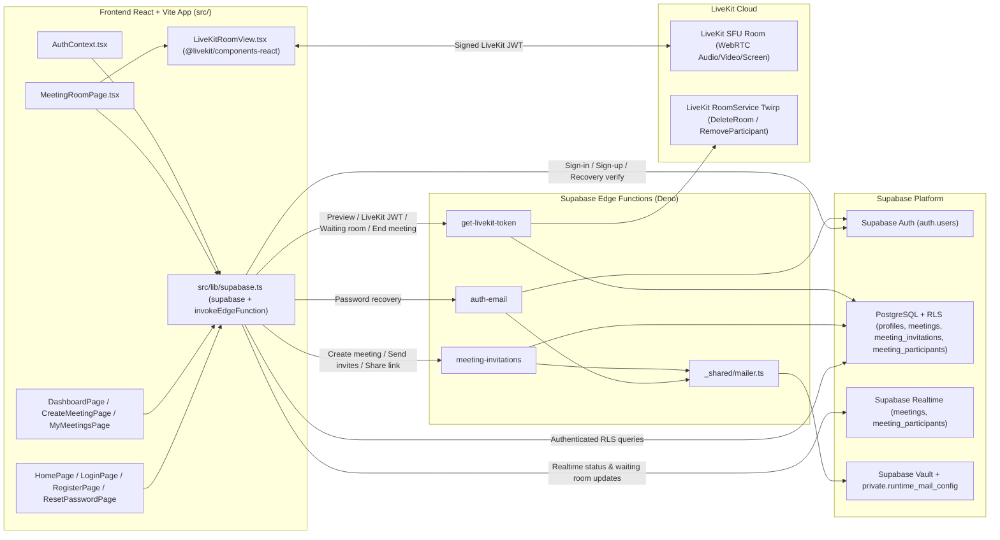

# VarTa — File Connections & End-to-End Data Flow

This document maps how **VarTa** connects the React frontend, Supabase Auth/Postgres/Realtime/Vault, Edge Functions, and LiveKit Cloud.

---

## 1. System Architecture Diagram

---

## 2. End-to-End Flows

1. **Account Auth & Redirect Preservation**
   - `App.tsx` wraps routes in `MotionConfig`, `ToastProvider`, and `AuthProvider` (`AuthContext.tsx`).
   - Unauthenticated visitors opening `/create-meeting` or `/dashboard` are redirected to `/login?redirect=...`.
   - `LoginPage.tsx` calls `supabase.auth.signInWithPassword()` (or `auth-email` for recovery) and navigates back via `sanitizeRedirectPath(redirectParam)`.
   - `RegisterPage.tsx` creates the account with `supabase.auth.signUp()`, relies on Postgres trigger `private.handle_new_auth_user()` to populate `public.profiles`, and returns to `redirectParam`.

2. **Meeting Creation & Email Invitations**
   - `CreateMeetingPage.tsx` submits meeting title, instant/scheduled toggle, waiting room preference, and optional recipient emails to `meeting-invitations` (`action: 'create_meeting'`).
   - `meeting-invitations` generates a unique `vrt-xxxx-xxxx` code, stores a SHA-256 hash for deterministic share links (`?invite=`) and per-recipient tokens (`?token=`), inserts into `meetings` + `meeting_invitations`, and dispatches emails through `_shared/mailer.ts`.

3. **Private Meeting Entry & Guest Flow**
   - Opening `/meeting/:code?token=...` or `/meeting/:code?invite=...` renders `MeetingRoomPage.tsx`.
   - On load, `MeetingRoomPage.tsx` calls `get-livekit-token` (`action: 'preview'`, `requireAuth = false`) to verify access and load safe meeting metadata.
   - Guests enter Full Name (required) and optional Email, or click Login / Sign Up (preserving the exact meeting URL).
   - Submitting Join calls `get-livekit-token` (`action: 'join_token'`), which records participation in `meeting_participants` and either returns `{ status: 'waiting_room' }` (polled / subscribed via Realtime until admitted) or `{ status: 'admitted', token, server_url }`.

4. **Real-Time LiveKit Call Lifecycle**
   - `LiveKitRoomView.tsx` and `MeetingStageTiles.tsx` connect to LiveKit Cloud using the server-minted HS256 JWT (`roomAdmin: isOrganizer`), automatically switch between Screen Share, Click-to-Focus, and Collage Gallery layouts without dropping tracks, highlight active speakers via `useIsSpeaking()`, and allow organizers to admit/remove participants or end the meeting (`RoomService/DeleteRoom`).
