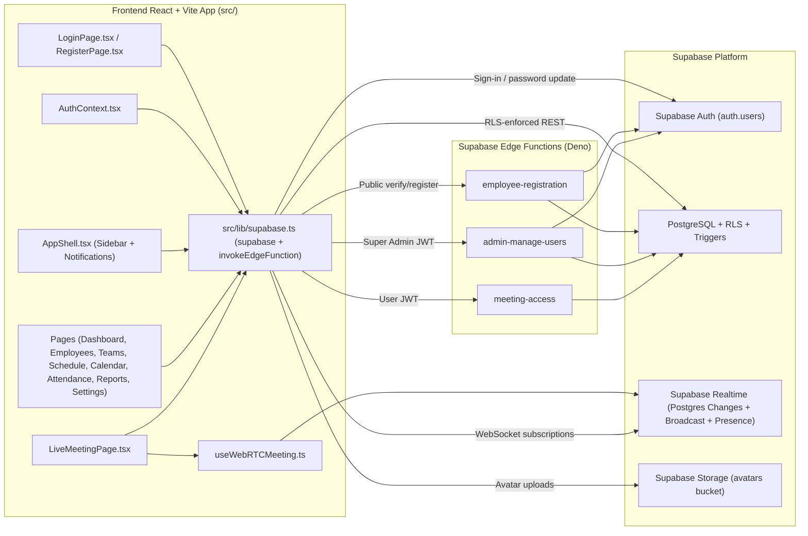
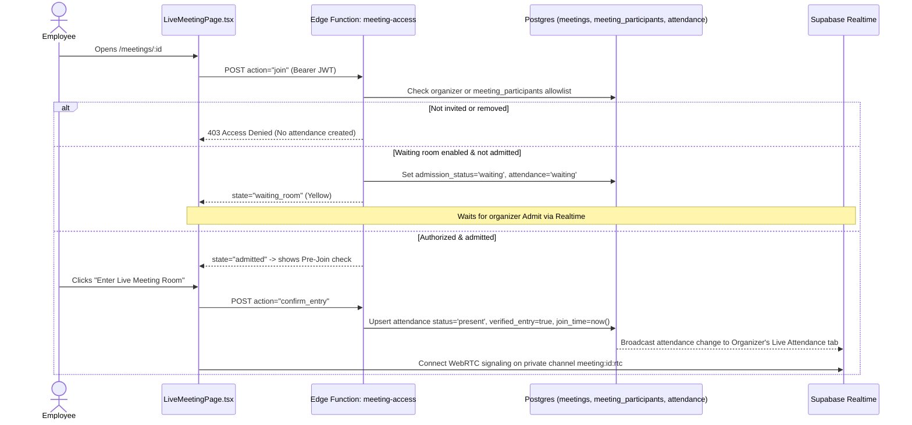

# VarTa — File Connections & End-to-End Data Flow

This document maps how every layer of **VarTa** communicates across React components, Contexts, Hooks, Supabase Client/Realtime/Storage, Edge Functions, and PostgreSQL tables.

---

## 1. High-Level System Communication Diagram

---

## 2. File-to-File Interconnection Matrix

### Root & App Entry
- **`index.html`** -> loads `/src/main.tsx`.
- **`src/main.tsx`** -> imports `src/index.css` and renders `src/App.tsx`.
- **`src/App.tsx`** -> wraps routes in `MotionConfig`, `ToastProvider` (`src/contexts/ToastContext.tsx`), and `AuthProvider` (`src/contexts/AuthContext.tsx`); routes authenticated pages inside `AppShell` (`src/components/layout/AppShell.tsx`).

### Identity & Session Pipeline
- **`src/contexts/AuthContext.tsx`**
  - Imports `supabase` from `src/lib/supabase.ts` and `Employee`/`UserRole` from `src/types/database.ts`.
  - Queries `public.employees` (with `departments!employees_department_id_fkey` and `teams!employees_team_id_fkey`) and `public.user_roles`.
  - Consumed by `App.tsx`, `AppShell.tsx`, `LoginPage.tsx`, `RegisterPage.tsx`, and all protected pages.
- **`src/pages/LoginPage.tsx`**
  - Calls `supabase.auth.signInWithPassword()`, then `refreshProfile()` in `AuthContext.tsx`, then navigates to `/dashboard`.
- **`src/pages/RegisterPage.tsx`**
  - Calls `invokeEdgeFunction('employee-registration', ..., false)` -> Edge Function `supabase/functions/employee-registration/index.ts`.
  - Signs into Supabase Auth with `supabase.auth.signInWithPassword()`, calls `refreshProfile()`, and navigates to `/dashboard`.

### Navigation & Notifications Shell
- **`src/components/layout/AppShell.tsx`**
  - Reads `employee`, `role`, `signOut` from `AuthContext.tsx`.
  - Subscribes via `supabase.ts` Realtime `postgres_changes` to `public.notifications` (filtered by `recipient_employee_id`) and `public.meetings` (live meeting badge counter).
  - Clicking a notification navigates directly to `LiveMeetingPage.tsx` (`/meetings/:id`).

### Organization, Employee & Team Management Flow
- **`src/components/admin/AdminModulesSection.tsx`**
  - Embedded inside `DashboardPage.tsx` (`role === 'super_admin'`) uniting `EmployeeManagementPanel.tsx`, `DepartmentManagementPanel.tsx`, `DesignationManagementPanel.tsx`, `LeadershipManagementPanel.tsx`, and `MeetingManagementPanel.tsx`.
- **`src/components/employees/EmployeeFormModal.tsx`**
  - Shared form modal used by `AdminModulesSection.tsx`, `TeamsPage.tsx`, and `EmployeesPage.tsx`.
  - Dynamically populates active `departments` (ordered by `display_order`) and filters `designations` to the chosen department, supports all 7 `EmployeeCategoryOption` tiers (`founder`, `managing_director`, `director`, `leadership`, `department_head`, `manager`, `employee`), uploads photos to `avatars`, sets `Active / Inactive / Invited` status, and invokes `admin-manage-users` (`create_employee` / `update_employee`).
- **`src/pages/TeamsPage.tsx`**
  - Queries `employees`, `departments`, `designations`, `teams` and subscribes via `supabase_realtime`.
  - Renders 5 organizational tiers: (1) Founders & Managing Director, (2) Associate Director & Leadership, (3) Department Heads, (4) Managers, and (5) Employees ("Meet Our Team"), with department pill filters and live search.
- **`src/pages/EmployeesPage.tsx`**
  - Tabbed Super Admin console sharing `EmployeeManagementPanel.tsx`, `DepartmentManagementPanel.tsx`, `DesignationManagementPanel.tsx`, `LeadershipManagementPanel.tsx`, and `EmployeeFormModal.tsx`.
  - Enforces safe deletion triggers (`prevent_in_use_department_delete_trg`, `prevent_in_use_designation_delete_trg`) and archive-safe employee removal via `admin-manage-users`.

### Scheduling, Calendar & Meeting Directory Flow
- **`src/pages/ScheduleMeetingPage.tsx`**
  - Queries active `employees` (`status = 'active'`), active `departments`, `teams`, and `platform_settings` via `supabase.ts`.
  - Supports multi-department chips (`Audio Visual (AV)`, `IT & Networking`, etc.), whole-department selection, group invites (Department Heads, Managers, Leadership), individual Employee ID/name search, and live participant preview before saving.
  - Writes `invited_department_ids` on `meetings`, `invited_email` + `invitation_source` on `meeting_participants`, in-app `notifications`, and invokes `meeting-access` (`check_conflicts`, `dispatch_schedule_invites`).
- **`src/pages/CalendarPage.tsx`**
  - Queries and subscribes via Realtime to `meetings` (joined with `employees`, `meeting_participants`, `meeting_agenda`).
  - Updates `meetings` for reschedule/cancel (enforced by Postgres RLS + `enforce_meeting_integrity` trigger) and writes `notifications`.
  - Navigates to `LiveMeetingPage.tsx` (`/meetings/:id`).
- **`src/pages/MyMeetingsPage.tsx`**
  - Queries & subscribes to `meetings`; calls `meeting-access` (`start_meeting`) for hosts; routes to `LiveMeetingPage.tsx` or `AttendancePage.tsx`.

### Live Video Meeting, Attendance & Chat Flow
- **`src/pages/LiveMeetingPage.tsx`** <-> **`src/hooks/useWebRTCMeeting.ts`** <-> **`supabase/functions/meeting-access/index.ts`**
  1. On mount, `LiveMeetingPage.tsx` calls `meeting-access` (`action: 'join'`).
  2. Unauthorized users receive `403` and stay on the `Access Restricted` screen.
  3. Waiting room users stay on `waiting_room` (`attendance.status = 'waiting'`) until Realtime `meeting_participants` update marks `admission_status = 'admitted'`.
  4. When the user clicks **Enter Live Meeting Room**, `LiveMeetingPage.tsx` calls `meeting-access` (`action: 'confirm_entry'`), marking `attendance.status = 'present'` and activating `gateState = 'in_call'`.
  5. `useWebRTCMeeting.ts` joins private Realtime channel `meeting:<id>:rtc` (authorized by `private.can_access_realtime_topic()`), exchanges WebRTC SDP/ICE messages via Broadcast, tracks peers via Presence, and streams `<video>` tracks.
  6. Periodic `heartbeat` (25s) and `leave` calls update `total_duration_seconds` in `public.attendance`.
  7. Live Chat reads/inserts `public.meeting_messages` over RLS + Realtime `postgres_changes`.
  8. Host clicking **End Meeting** calls `meeting-access` (`end_meeting`), setting `meetings.status = 'completed'`, finalizing active attendee durations, and marking remaining unjoined invitees `'absent'`.

### Attendance, Reports & Settings Flow
- **`src/pages/AttendancePage.tsx`** & **`src/pages/ReportsPage.tsx`**
  - Query `attendance` joined with `employees`, `departments`, `teams`, and `meetings` under role-scoped RLS.
  - Pass formatted rows to `src/lib/export.ts` (`exportAttendanceCSV`, `exportAttendanceExcel`).
- **`src/pages/SettingsPage.tsx`**
  - Uploads personal avatar to Supabase Storage `avatars/<auth.uid()>/...`.
  - Updates permitted personal fields (`phone`, `bio`, `avatar_url`) on `public.employees` (protected by `protect_employee_columns_trg`).
  - Updates password via `supabase.auth.updateUser()` and organization settings via `public.platform_settings` (Super Admin only).

---

## 3. Sequence Diagram: Meeting Entry & Verified Attendance

